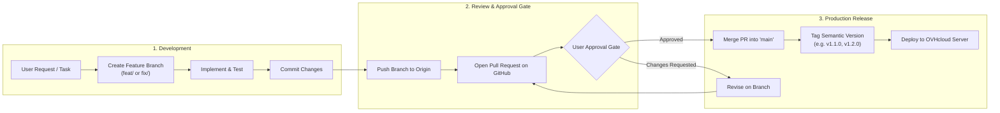

# DriveConnector - Self-Hosted Media Streaming & On-Demand Ingestion Platform

A hardened, high-performance self-hosted video streaming and on-demand ingestion web application designed for OVHcloud Linux servers with attached 1TB+ Block Storage volumes (`/mnt/storage`).

---

## 📊 System Architecture & Data Flow Chart

```mermaid
flowchart TD
    subgraph Client ["Client Browser"]
        UI["Web UI (React / Tailwind)"]
        Player["Plyr Video Player"]
        HUD["Live Transfer Overlay"]
    end

    subgraph Backend ["FastAPI Backend Engine (Port 8000)"]
        Auth["JWT Auth / RBAC"]
        StreamAPI["HTTP 206 Range Engine (/api/stream)"]
        WS["WebSocket Telemetry (/ws/transfers)"]
        Downloader["Downloader Engine (Drive & yt-dlp)"]
        CatalogSync["Drive Catalog Sync (Drive API v3)"]
    end

    subgraph Workers ["Async Background Workers"]
        FFmpeg["FFmpeg Pipeline (Poster, 4s Preview Loop, VTT Sprites)"]
    end

    subgraph Storage ["OVHcloud 1TB Block Storage (/mnt/storage)"]
        MongoDB[("MongoDB 7.0 (/mnt/storage/mongodb)")]
        VideoFiles[("Video Payloads (/mnt/storage/videos)")]
        MetaFiles[("Asset Metadata (/mnt/storage/metadata)")]
    end

    subgraph Cloud ["External Cloud Sources"]
        GDrive["Google Drive (Remote Video Files)"]
        ExtURL["External Links (YouTube, Direct MP4)"]
    end

    %% Flow 1: Lightweight Sync
    UI -->|1. Sync Catalog (No disk usage)| CatalogSync
    CatalogSync -->|Scan Metadata & Poster| GDrive
    CatalogSync -->|Store REMOTE_ONLY docs| MongoDB

    %% Flow 2: On-Demand Fetching
    UI -->|2. Click Play on Remote Video| Downloader
    ExtURL -.->|Add URL| Downloader
    Downloader -->|High-speed stream| GDrive
    Downloader -->|Save .mp4 payload| VideoFiles
    Downloader -.->|Live MB/s, ETA, %| WS -.-> HUD

    %% Flow 3: Automated Processing
    Downloader -->|Download complete -> Trigger| FFmpeg
    FFmpeg -->|Extract poster.jpg, preview.mp4, sprites.jpg, thumbnails.vtt| MetaFiles
    FFmpeg -->|Update status to LOCAL_READY| MongoDB

    %% Flow 4: High-Performance Streaming
    Player -->|3. HTTP 206 Range Request| StreamAPI
    StreamAPI -->|Stream 4MB chunks| VideoFiles
    Player -->|Scrub seekbar with thumbnails.vtt| MetaFiles
```

---

## 🔀 Git Versioning & Pull Request Approval Workflow

All changes follow a strict Pull Request gate protocol before landing on `main`:



---

## 🔑 Default Admin Credentials

When the system boots for the first time, an administrator account is automatically created in MongoDB:

- **Username**: `admin`
- **Password**: `Admin@Drive2026!`
- **Role**: `admin`

*(You can customize these defaults anytime in `.env` via `ADMIN_USERNAME` and `ADMIN_DEFAULT_PASSWORD`)*.

---

## 5 Core Features

1. **Database & Storage Architecture (MongoDB + Mongo Express UI + 1TB Block Storage)**:
   - Persistent database stored directly on `/mnt/storage/mongodb`.
   - Web-based MongoDB Admin UI on port `8081` via Mongo Express.
   - High-bitrate videos stored in `/mnt/storage/videos`.
   - Asset thumbnails, previews, and sprite sheets stored in `/mnt/storage/metadata/{video_id}/`.

2. **Lightweight Google Drive Catalog Sync (0 GB Disk Used Upfront)**:
   - Scans Google Drive for video files via Google Drive API v3.
   - Fetches file metadata and high-definition poster thumbnails (upgraded to 1280px).
   - Inserts records into MongoDB with `status: "REMOTE_ONLY"` without downloading video payloads.

3. **On-Demand Click-to-Download & External Link Ingestion with Live Progress**:
   - Clicking "Play" on a `REMOTE_ONLY` video triggers high-speed stream download directly into `/mnt/storage/videos/{video_id}.mp4`.
   - External URL Downloader supports direct MP4 links, YouTube, Vimeo, and custom video streams via `yt-dlp`.
   - Live telemetry via WebSockets (`/ws/transfers`): Speed (MB/s), MB/GB remaining, ETA, and percentage.
   - Auto-plays in the video player as soon as download completes.

4. **Automated FFmpeg Video Processing Pipeline**:
   - `poster.jpg`: High-quality frame extracted at 10% duration.
   - `preview.mp4`: 4-second muted, low-bitrate looping MP4 compiled from 4 cross-video clips for instant hover cards.
   - `sprites.jpg` & `thumbnails.vtt`: 1 frame every 5s scaled to 160x90 tiled in a 10-column sprite sheet with pixel-perfect `#xywh=` coordinates.

5. **Streaming UI & Seekbar Scrubbing Player**:
   - Video Grid with card hover video preview loops.
   - Video player with HTTP 206 Partial Content Range streaming.
   - Seekbar hover scrubbing powered by WebVTT sprites.
   - Live disk usage gauge for the 1TB Block Storage volume.

---

## Quick Start on OVHcloud Linux Server

### 1. Mount & Prepare 1TB Block Storage
```bash
sudo mkdir -p /mnt/storage/mongodb /mnt/storage/videos /mnt/storage/metadata
sudo chown -R 1000:1000 /mnt/storage
```

### 2. Configure Environment & Credentials
```bash
cd driveConnector
cp .env.example .env
```

### 3. Launch Services via Docker Compose
```bash
docker compose up -d --build
```

### 4. Access the Application
- **Media Streamer Web App**: `http://<SERVER_IP>:8000/`
  - Click **Sign In** with Username `admin` / Password `Admin@Drive2026!`
- **Mongo Express Database UI**: Accessible locally at `http://127.0.0.1:8081/` (or via SSH tunnel: `ssh -L 8081:localhost:8081 user@<SERVER_IP>`)
